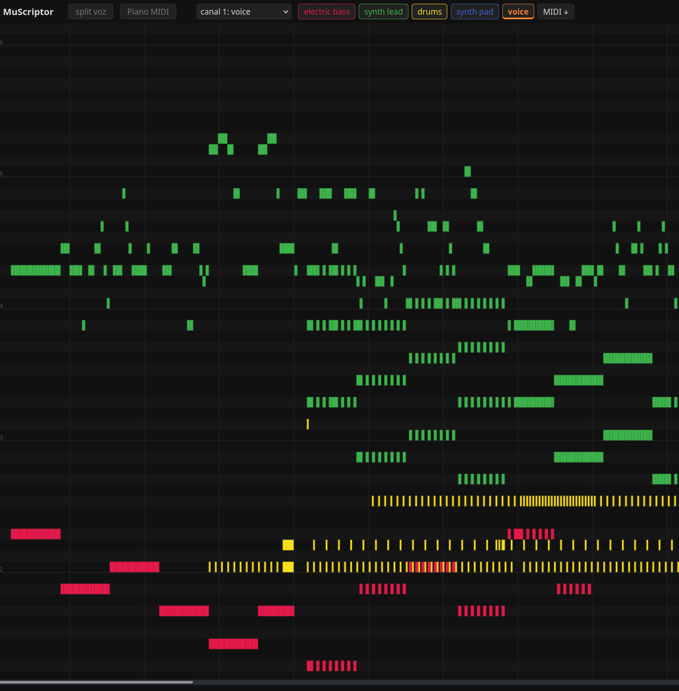

# MidiToMp3

**Official Reference Implementation of the Audio-to-Note Reconciliation Protocol (ANRP), Revision 0.0.3-final-FINAL**

**[Live demo](https://franciscocarloserra.github.io/mp3tomidi/)**. Certified for public listening under Annex Q.

## 1. Scope

This document specifies a procedure for converting recorded sound into MIDI notes in accordance with no known standard. Conformance is mandatory for implementations that have chosen, of their own free will, to conform.

The Protocol uses two (2) neural networks, operating in the following order of precedence:

- [MuScriptor](https://github.com/muscriptor/muscriptor) (hereinafter "the Transcriber") listens to the audio and records every note of every instrument.
- [Demucs htdemucs](https://github.com/facebookresearch/demucs) (hereinafter "the Separator") detaches the vocalist from the mix. The vocalist has not been consulted.

## 2. Normative Pipeline

2.1. The Submitter MUST drop a file onto the panel. The panel SHALL forward it to `serve.py` at `POST /convert`.

2.2. The Transcriber SHALL process the audio in 5-second chunks, which the Committee considers the maximum duration a note may be observed without supervision. Note on/off events SHALL be streamed over SSE so that the piano roll fills in live. Each detected instrument SHALL be assigned one (1) color and one (1) track button.

2.3. On completion, a beat grid SHALL be detected (beat_this) and a `.mid` file SHALL be issued to the Submitter. The `.mid` file has no legal standing.

2.4. On activation of the "split vocals" control, the same file SHALL be sent to `POST /voice`. `separate.py` runs the Separator on the GPU and returns the vocals stem, which the panel SHALL align with the MIDI using the beat grid's onset delay, to within a tolerance the Committee declined to define.

2.5. Playback SHALL go through a WebAudio synthesizer of the lowest acceptable fidelity, OR, at the Submitter's discretion, through Web MIDI to a physical keyboard: one channel and one General MIDI program per instrument, with drums on channel 10 as established by precedent and fear.

2.6. Results SHALL be cached per file in `data/<sha1>.jsonl` (plus `.mid` and `_stems/`). A file submitted twice SHALL be answered instantly. An interrupted transcription SHALL resume from its last completed chunk, and SHALL NOT mention the interruption.

## 3. Installation Procedure

    python -m venv .venv && .venv/bin/pip install muscriptor
    pip install demucs          # any python; designate it via DEMUCS_PYTHON (default: python3)
    .venv/bin/python serve.py   # service on :6977
    cd web && python3 -m http.server 7808   # panel at http://localhost:7808

3.1. `MUSCRIPTOR_WEIGHTS` selects the weights: `large` (default, downloaded from HuggingFace on first run, after the license has been accepted there) or a local `.safetensors` path.

3.2. The large model requires ~11 GB of VRAM. On an RTX 3090, 15 s of audio takes ~25 s to transcribe. Implementations are reminded that this is slower than listening to the song, and that this is permitted.

## 4. Operator Controls

| Action | Effect |
|---|---|
| Click on the roll | Play / stop |
| Ctrl+wheel, `+`, `-` | Horizontal zoom |
| Click on a track | Mute |
| Double click on a track | Solo; a second double click restores the ensemble |
| `midi` / `vocals` sliders | Volume of the MIDI playback (CC7 on a keyboard) and of the separated vocals |
| Right click on a track | Assigns the track to MIDI channel 1 (the one the keyboard displays) |

## 5. The Robot

5.1. A robot is provided. Its presence is not optional.

5.2. Operators on the same network MAY open `http://<this-ip>:6977/robot` on a mobile device. While the panel plays the vocals stem, the robot SHALL dance in proportion to the vocalist's loudness.

5.3. Above the loudness threshold, the robot SHALL raise its arms, strobe and emit sparks. This behavior is compliant.

## 6. Demonstration Material

The [live demo](https://franciscocarloserra.github.io/mp3tomidi/) replays one cached transcription and its isolated vocals. The source recording is AI-generated slop and is free of copyright, artistic merit and remorse. The demo cannot transcribe new files: no GPU was allocated to the static site, and the appeal was denied.

## 7. Known Deviations

7.1. The Transcriber outputs no velocity. All notes are played at the same level of enthusiasm.

7.2. The synthesizer is not a soundfont and makes no representations to the contrary.
